# SQL Viz — SQL 可视化学习 · 测试数据生成 · 血缘分析 · BI 报表 · 数据探查 · RAG 转 SQL · 数据建模平台

<p align="center">
  
  
  
  
  
  
  
</p>

> 一个面向 SQL 学习者与数据开发者的多功能工具平台：用 Canvas 动画「看见」SQL 函数的执行过程，用 LLM 一键生成测试数据集，对 SQL/HQL 脚本做表级血缘分析，上传 Excel/CSV 自助生成可视化大屏报表，连接真实库做只读探查并一键生成数据质量脚本，基于 RAG 知识库用自然语言生成对齐业务模型的 SQL，以及一套完整的数据建模平台。

前后端分离架构：**React 19 + Vite 7 + TypeScript**（前端）/ **FastAPI + Python**（后端）。

---

## 🖼️ 界面预览

<table>
  <tr>
    <td align="center" width="50%">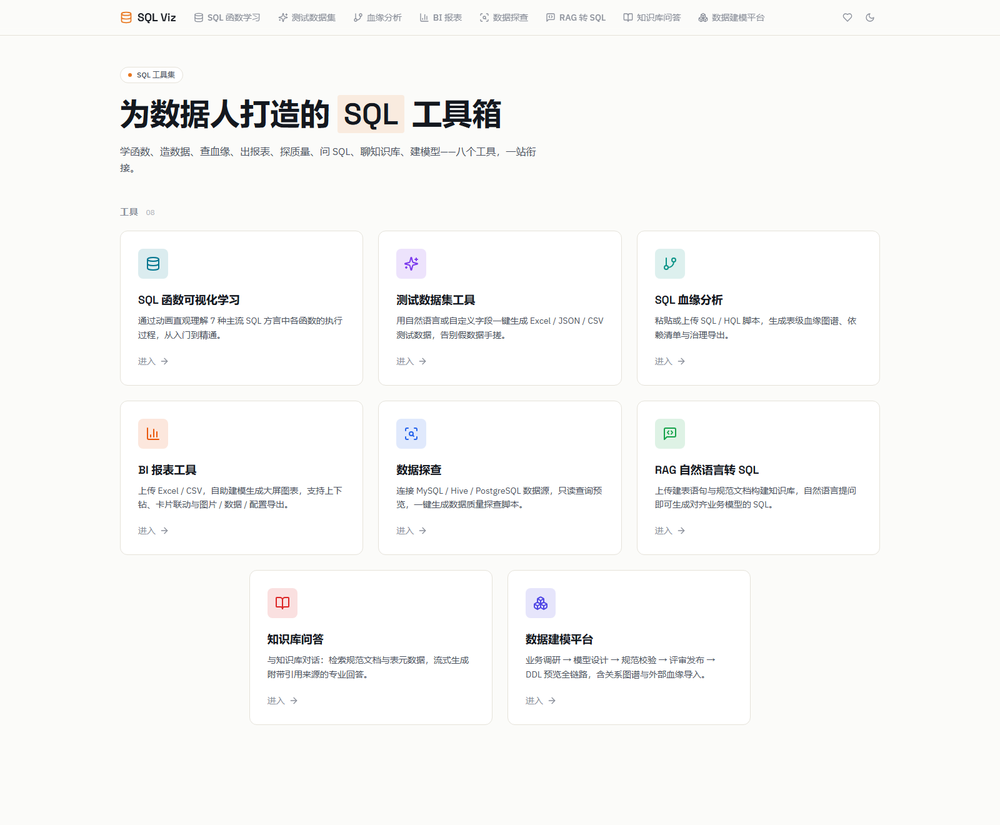<br><b>首页</b> · 八个工具一站衔接</td>
    <td align="center" width="50%">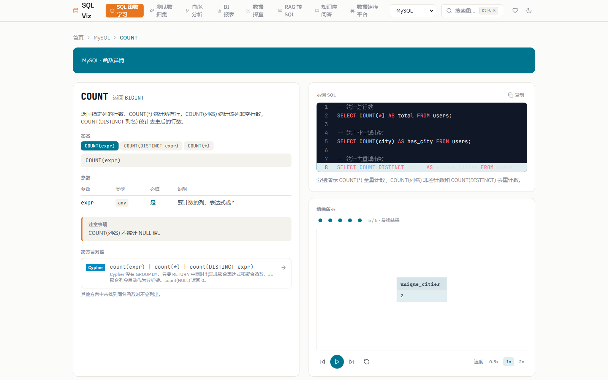<br><b>SQL 函数可视化</b> · 签名 / 参数 / 跨方言对照 / 动画演示</td>
  </tr>
  <tr>
    <td align="center">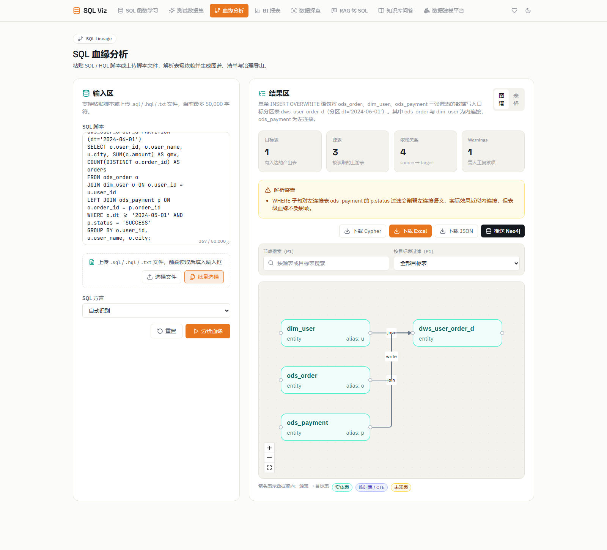<br><b>SQL 血缘分析</b> · 摘要 + 图谱 + 清单 + 治理导出</td>
    <td align="center">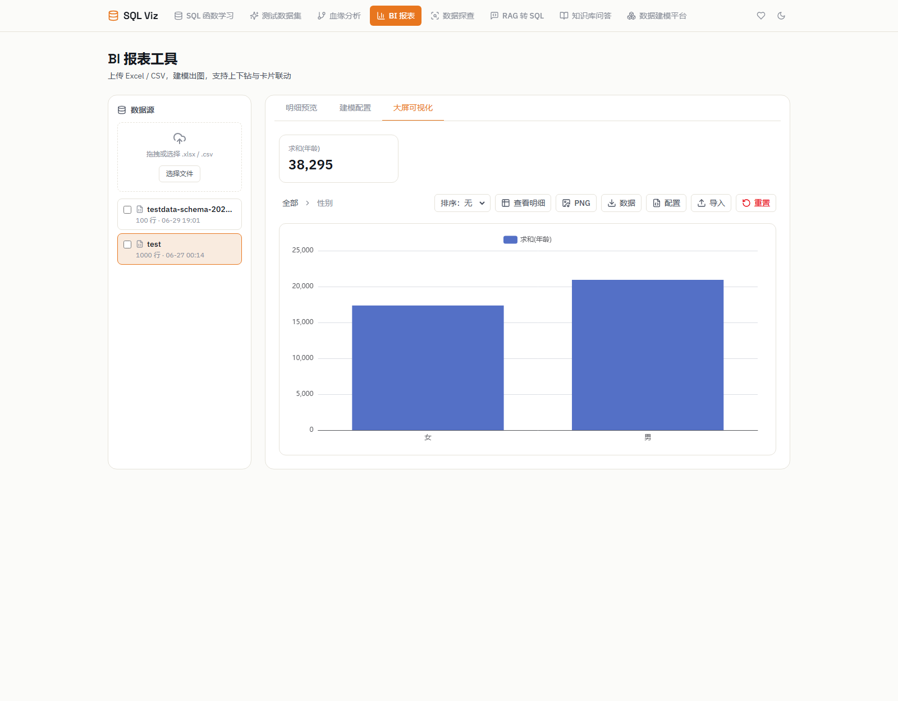<br><b>BI 报表</b> · 建模后的大屏可视化与下钻</td>
  </tr>
  <tr>
    <td align="center">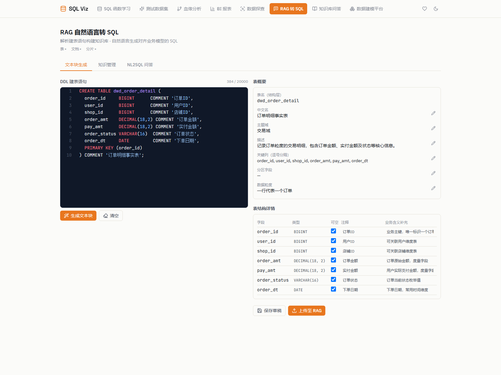<br><b>RAG 转 SQL</b> · DDL 解析为可编辑的表元数据</td>
    <td align="center">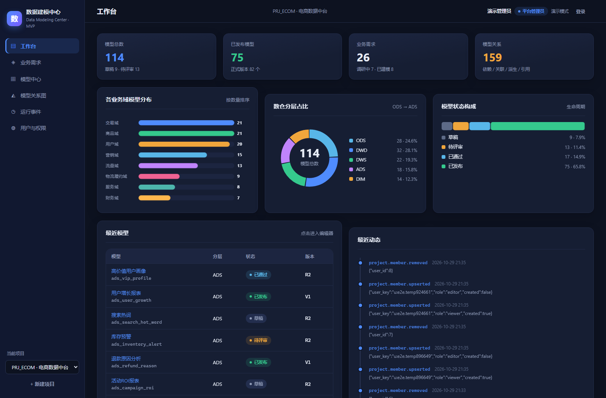<br><b>数据建模平台</b> · 工作台总览与数仓分层</td>
  </tr>
</table>

---

## 📦 模块详解

### 1. SQL 函数可视化学习

覆盖 **MySQL / PostgreSQL / Hive / Impala / SparkSQL / FlinkSQL / Cypher** 7 种方言、共 303 个函数。按分类浏览函数，查看签名 / 参数 / 示例 / 返回值，并通过自研 Canvas 动画引擎逐步骤演示 `WHERE` / `JOIN` / `GROUP BY` 等数据变换过程——SQL 代码与动画步骤联动高亮。支持全局搜索、跨方言对照、收藏与最近查看。

<table>
  <tr>
    <td align="center" width="50%">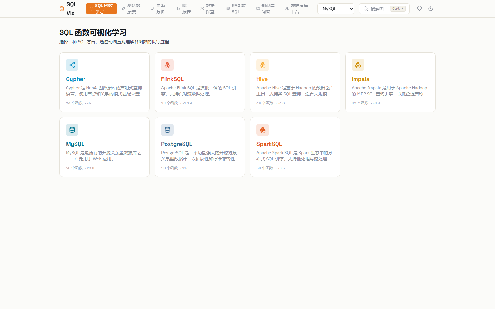</td>
    <td align="center" width="50%">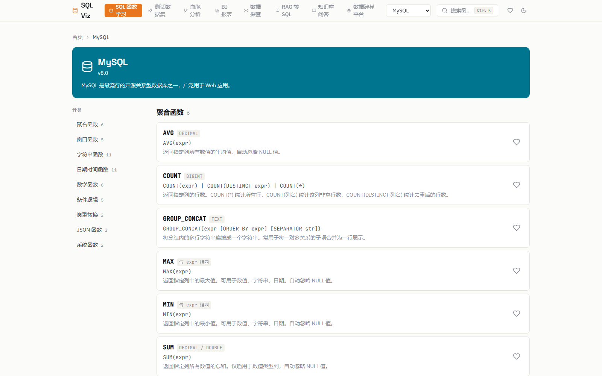</td>
  </tr>
</table>

### 2. 测试数据集工具

两种模式生成结构化测试数据：**自然语言描述**（「生成 50 条电商订单，含金额与状态」）或**自定义字段**（逐列指定类型 / 描述 / 枚举值，也支持上传 xlsx/csv 解析表头快速建表）。调用 LLM 生成，支持 xlsx / json / csv 一键导出。

<table>
  <tr>
    <td align="center" width="50%">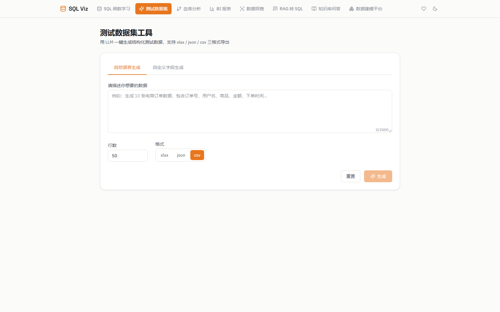</td>
    <td align="center" width="50%">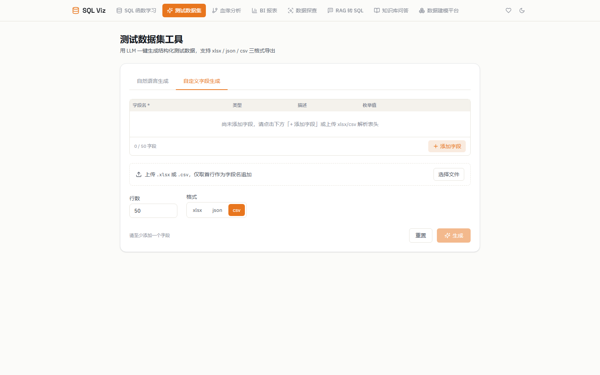</td>
  </tr>
</table>

### 3. SQL 血缘分析

粘贴或上传 SQL / HQL 脚本，解析表级依赖，一次给出**目标表 / 源表 / 依赖关系 / Warnings** 四项摘要、血缘图谱、依赖清单，并支持导出 Cypher / Excel / JSON、推送 Neo4j。解析告警会明确告诉你哪些行号信息缺失、哪些已被 SQL 原文补全。


### 4. BI 报表工具

上传 xlsx / csv（支持 Excel 多级表头）由后端 pandas 解析落盘；前端做**维度 / 指标 / 下钻层级 / 图表类型 / 配色**建模后生成 ECharts 大屏：柱状 / 折线 / 饼图 / 散点图 / 组合图 / **中国地图**（省级↔城市级下钻联动）七种图表 + 四套配色。支持点击下钻、面包屑上钻、总览卡片与明细联动、表头与大屏排序；可导出 PNG / 数据 / 仪表盘配置。城市级地图经后端代理拉取 DataV 边界并磁盘缓存，规避浏览器跨域 403。

<table>
  <tr>
    <td align="center" width="50%">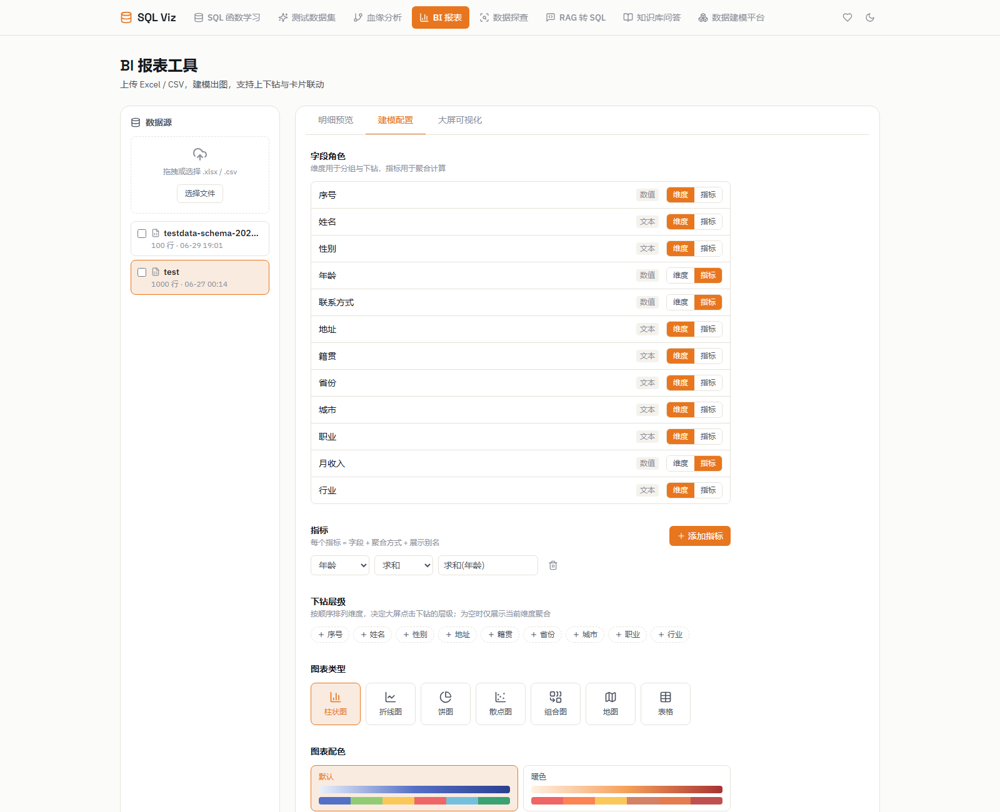</td>
    <td align="center" width="50%"></td>
  </tr>
</table>

### 5. 数据探查

配置连接 **MySQL / Hive / PostgreSQL** 数据源（会话级连接池、凭证仅驻留内存不落盘，刷新需重连），在工作台做只读 SQL 查询与分页预览（sqlglot 静态拦截 DML/DDL/多语句、超时与行数护栏、结果下载）。内置 10 项常见质量指标模板（零 LLM）+ 自定义规则（few-shot 仿写 LLM 生成），为指定表或库一键生成数据质量探查脚本，经静态分析与 EXPLAIN 试运行校验后可导入工作台执行或下载 `.sql`。

<table>
  <tr>
    <td align="center" width="50%">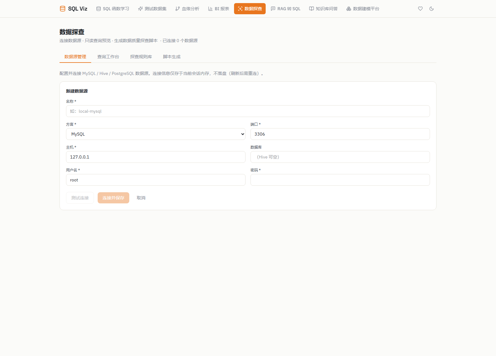</td>
    <td align="center" width="50%">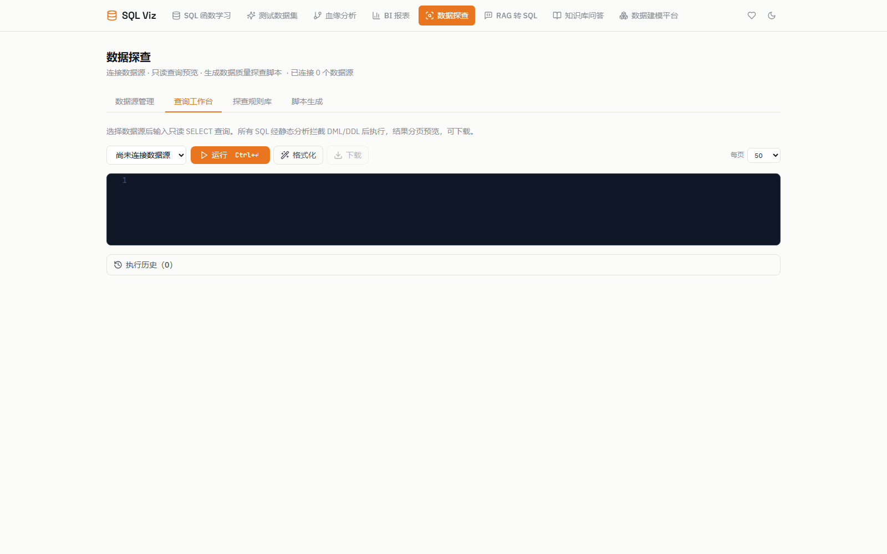</td>
  </tr>
</table>

### 6. RAG 自然语言转 SQL

粘贴建表 DDL，由 sqlglot 结构化解析 + LLM 语义改写为**可编辑的表元数据文本块**（表名 / 中文名 / 主题域 / 描述 / 关键列 / 分区字段 / 数据粒度 + 逐字段业务含义），并可上传 SQL / 建模 / 质量规范文档切片入库（外部托管 Milvus / Zilliz）。自然语言提问时混合检索（向量 + BM25，RRF 融合）召回相关表与文档、Rerank 重排后作为上下文增强 LLM 生成符合业务模型的 SQL，sqlglot 静态校验、来源可追溯，支持多轮会话与流式输出。


### 7. 知识库问答

与知识库对话：检索规范文档与表元数据，流式生成**附带引用来源**的专业回答。多会话管理，预设问题一键提问。

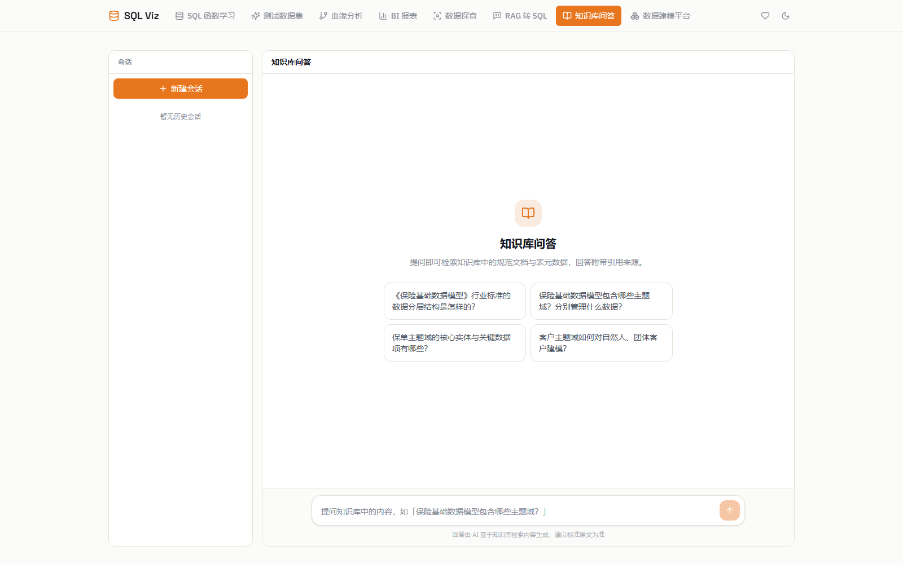

### 8. 数据建模平台

并入的完整建模子系统（原为独立项目，现由首页「数据建模平台」卡片以全屏 iframe 进入）：**业务调研**（主题域 / 业务需求）→ **模型设计**（字段 / 表级约束 / 索引 / 关系）→ **22 条规范校验** → **评审发布** → **版本差异** → **DDL 预览**（PG / MySQL / Hive 三引擎，只生成不执行）全链路。附模型关系图画布（力导向 / 分层布局、缩放拖拽、四视图切换）、图谱快照与 diff、最短路径、外部血缘导入（dbt manifest 连接器）、Kimball 业务总线矩阵，以及平台 admin + 项目 owner/editor/viewer 两级 RBAC 与账号密码登录。

演示数据分两档：**空库首次启动**会自动建库迁移并注入最小演示集（`PRJ_RETAIL`：1 个项目 / 2 个模型，可立即体验完整闭环）；本地开发库另有一套**电商数仓分层**数据（`PRJ_ECOM`：114 个模型，ODS 28 / DWD 32 / DIM 14 / DWS 22 / ADS 18，801 个字段、159 条关系、82 个发布快照、26 条业务需求），用于图谱 / 血缘 / 快照等大规模场景的全功能演示——即上方截图所见。该库文件位于 `backend/data/platform.db`，已在 `.gitignore` 中，克隆仓库不会带入。

<table>
  <tr>
    <td align="center" width="50%">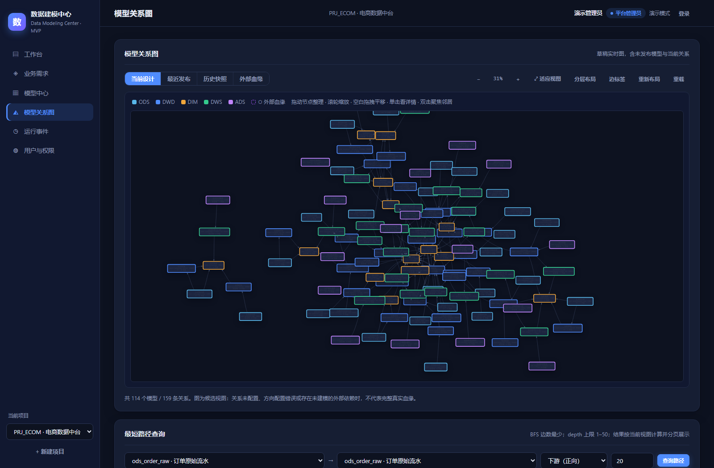</td>
    <td align="center" width="50%">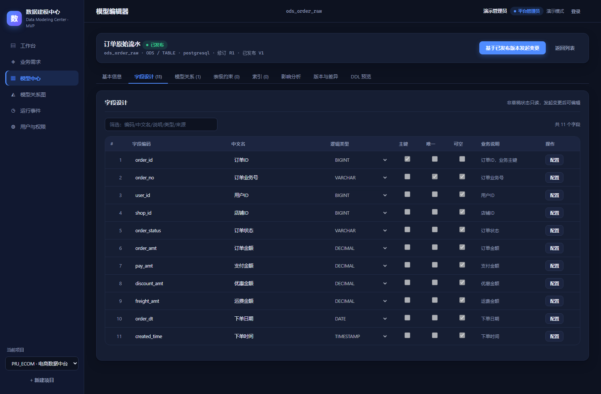</td>
  </tr>
  <tr>
    <td align="center">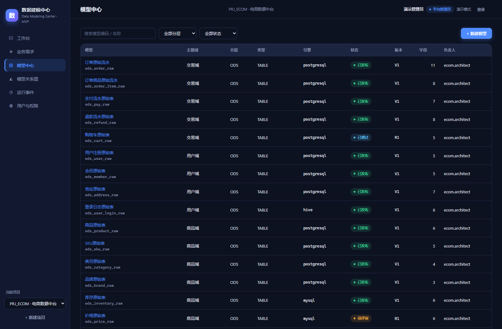</td>
    <td align="center">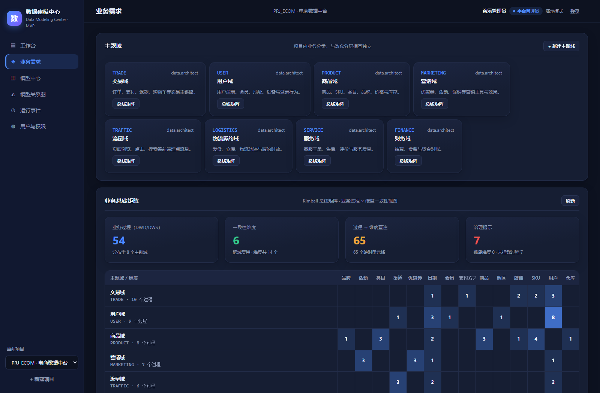</td>
  </tr>
  <tr>
    <td align="center" colspan="2">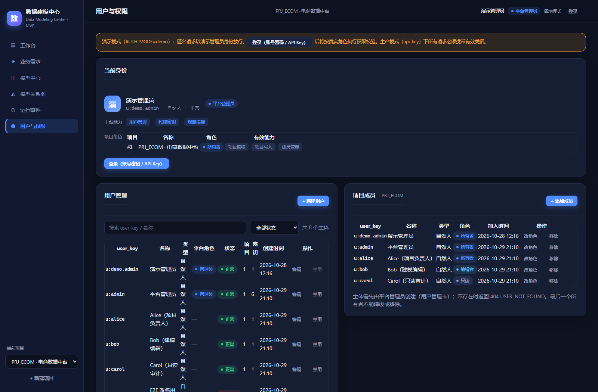</td>
  </tr>
</table>

---

## 🧰 技术栈

**前端**：React 19 · Vite 7 · TypeScript 5 · React Router 7 · Zustand 5 · TanStack Query 5 · Tailwind CSS 4 · 原生 Canvas 2D · ECharts 6（+ echarts-for-react）· Shiki · @xyflow/react · Lucide · Sonner · xlsx
**后端**：FastAPI · Uvicorn · Pydantic 2 · OpenAI SDK（兼容 DeepSeek / 火山 doubao 等）· sqlglot · neo4j · SQLAlchemy 2.x + Alembic（数据建模平台 ORM 与迁移）· pandas / openpyxl / pyarrow（BI 报表数据处理）· pymilvus / rank-bm25（RAG 向量检索 + BM25）· pymysql / psycopg[binary] / pyhive+thrift（数据探查数据源连接）· httpx · pytest
**包管理**：前端 pnpm，后端 pip + requirements.txt

---

## 📁 目录结构

```
LLM_PROJ_BD/
├── frontend/              # React + Vite 前端
│   ├── src/
│   │   ├── pages/         # HomePage / SqlIndexPage / DialectPage / FunctionDetailPage / DataTestPage / LineagePage / BiReportPage / dataprofile / rag-sql / kbqa / ModelingPage
│   │   ├── components/    # global / animation / code / datatest / lineage / bi / shared
│   │   ├── engine/        # Canvas 动画引擎（CanvasEngine / AnimationController / renderers）
│   │   ├── lib/bi/        # chinaMap：地图省级归一化 + 城市级 GeoJSON 懒加载
│   │   ├── stores/        # Zustand 全局状态
│   │   ├── api/           # 请求封装 + TanStack Query hooks
│   │   ├── hooks/ lib/ types/
│   │   └── App.tsx
│   ├── package.json  vite.config.ts  tsconfig.json
│
├── backend/              # FastAPI 后端
│   ├── app/
│   │   ├── main.py       # 入口：CORS + 启动加载 + 路由注册 + /modeling 子应用挂载
│   │   ├── routers/      # dialects / functions / search / datatest / lineage / bi / dataprofile / rag_sql / kbqa
│   │   ├── services/     # 业务逻辑（bi_* / dataprofile_* / rag_sql_* / lineage_* 等）
│   │   ├── core/         # 配置 / 加载器 / 响应封装 / 缓存
│   │   ├── modeling/     # 数据建模平台（并入的独立子系统，挂载于 /modeling）
│   │   │                 #   main/config/db/models/auth/ddl/validation + alembic.ini
│   │   │                 #   + migrations/ + frontend/static/（其自带的工作台页面）
│   │   └── data/         # sql（7 方言 JSON）/ bi_datasets（落盘）/ profile_rules（探查自定义规则落盘）/ geo_cache（城市地图缓存，gitignore）
│   ├── tests/            # 宿主 pytest 测试（416 个）
│   │   └── modeling/     # 数据建模平台 pytest 测试（207 个，须单独跑，见「测试」一节）
│   ├── scripts/          # 一次性/演示脚本：ocr_pdf、seed_kb_doc、建模演示数据三件套
│   ├── pytest.ini        # testpaths=tests + norecursedirs=tests/modeling（隔离两套测试）
│   ├── requirements.txt
│   └── .env.example      # 环境变量模板（复制为 .env 后填写）
│
└── docs/
    └── screenshots/      # README 展示用截图（入库）
```

---

## 🚀 快速开始

### 环境要求
- Node.js ≥ 18，pnpm（`npm i -g pnpm`）
- Python ≥ 3.10

### 1. 启动后端（端口 8001）

```bash
cd backend
python -m venv .venv
# Windows:  .venv\Scripts\activate
# macOS/Linux:  source .venv/bin/activate
pip install -r requirements.txt

# 配置环境变量：复制模板并填写你自己的密钥
cp .env.example .env      # Windows 用：copy .env.example .env
# 编辑 .env，填入 OPENAI_API_KEY 等

uvicorn app.main:app --port 8001 --reload
```

### 2. 启动前端（端口 5173）

```bash
cd frontend
pnpm install
pnpm dev
```

打开浏览器访问 http://localhost:5173 。前端开发服务器会把 `/api` 与 `/modeling` 请求代理到后端 `127.0.0.1:8001`。

### 环境变量

后端所需变量见 `backend/.env.example`，主要包括：

| 变量 | 说明 |
|------|------|
| `OPENAI_API_KEY` | LLM API 密钥（测试数据 / 血缘分析 / 数据探查 / RAG 转 SQL 的 LLM 功能需要） |
| `OPENAI_BASE_URL` | LLM 接口地址（如使用 DeepSeek：`https://api.deepseek.com`） |
| `LLM_MODEL` | 模型名 |
| `NEO4J_*` | 可选，血缘结果推送 Neo4j 时使用 |
| `CORS_ORIGINS` | 可选，生产部署的允许来源（逗号分隔，未设则用本地开发地址） |
| `BI_MAX_UPLOAD_MB` | 可选，BI 报表上传文件大小上限（默认 10MB） |
| `PROFILE_*` | 可选，数据探查资源护栏：会话 TTL、查询超时、行数/单元格上限、Hive offset 上限、生成 EXPLAIN 重试次数等（见 `.env.example`，均有默认值） |
| `MILVUS_URI` / `MILVUS_TOKEN` | RAG 转 SQL：外部托管 Milvus / Zilliz Cloud 连接串与令牌（留空则入库/问答返回明确错误） |
| `EMBEDDING_*` | RAG 转 SQL：火山引擎 doubao 文本 embedding 的 `EMBEDDING_API_KEY` / `EMBEDDING_BASE_URL` / `EMBEDDING_MODEL` |
| `RERANK_*` | RAG 转 SQL：模力方舟 bge-reranker-v2-m3 的 `RERANK_API_KEY` / `RERANK_BASE_URL` / `RERANK_MODEL` |

> ⚠️ **切勿把真实的 `.env` 提交到仓库**。根目录 `.gitignore` 已忽略 `.env`，仅 `.env.example` 入库。

> ℹ️ **新增模块依赖说明**：数据探查的 MySQL / PostgreSQL 开箱即用（`pymysql` / `psycopg`）；Hive 依赖 `pyhive` + `thrift`，Windows 下安装易失败，代码会自动降级禁用该方言而不阻断启动。RAG 转 SQL 需外部 Milvus/Zilliz 向量库 + doubao embedding API + bge reranker API；未配置时该模块入库/问答返回明确错误，但不影响其余模块运行。

> ℹ️ **数据建模平台配置**：该子系统自带一套配置（`DATABASE_URL` / `AUTH_MODE` / `APP_ENV` / `AUTO_MIGRATE` / `SEED_DEMO_DATA` 等），优先级为「环境变量 > 仓库根目录 `config.yaml` > 内置默认值」。模板见 `backend/app/modeling/config.example.yaml`，需要自定义时复制到**仓库根目录**并命名为 `config.yaml`。不配置也能直接跑：默认在 `backend/data/platform.db` 自动建库迁移，并在空库时注入最小演示数据。演示账号 `admin` / `Admin@123456`（仅 `AUTH_MODE=demo` 本地演示）。**上生产前的开关切换见下文「☁️ 部署到 Render」。**

---

## 📜 可用脚本

**前端**（在 `frontend/` 下）
| 命令 | 作用 |
|------|------|
| `pnpm dev` | 启动开发服务器 |
| `pnpm build` | 类型检查 + 生产构建 |
| `pnpm preview` | 预览构建产物 |
| `pnpm typecheck` | 仅类型检查 |

**后端**（在 `backend/` 下）
| 命令 | 作用 |
|------|------|
| `uvicorn app.main:app --port 8001 --reload` | 启动 API（含 `/modeling` 子应用） |
| `pytest` | 宿主测试套件（416 个） |
| `pytest tests/modeling/ -v` | 数据建模平台测试套件（207 个，**须单独跑**，见下节） |
| `python scripts/check_modeling_seed_spec.py` | 建模演示数据规格静态校验（不触网、不写库） |
| `python scripts/seed_modeling_ecom.py` | 生成 114 模型电商数仓演示集（约 70s，839 次 API 调用） |
| `python scripts/verify_modeling_ecom.py` | 演示数据 API 层验收（29 项断言） |

---

## 🧪 测试

两套测试**分开跑**，不要合并成一次 `pytest`：

```bash
cd backend
pytest                    # 宿主：416 个
pytest tests/modeling/ -v # 数据建模平台：207 个
```

原因是数据建模平台的 `app.modeling.config.settings` 是**导入时**读取环境变量的模块级单例，`app.modeling.db.engine` 也在导入时按该 `DATABASE_URL` 建连；两套测试需要各自独立的临时库，只能靠「谁先导入谁绑定」来区分。混跑时若宿主测试先导入，建模平台的测试就会落到宿主的临时库上并大量报错（已实测：反向收集顺序下 222 个 error）。

`backend/pytest.ini` 里的 `norecursedirs = tests/modeling` 保证裸跑 `pytest` 只收宿主套件；显式传路径则可单独跑建模平台套件。两套的临时库分别由 `tests/conftest.py` 与 `tests/modeling/conftest.py` 设置，都不会碰 `backend/data/platform.db`。

---

## ☁️ 部署到 Render

数据建模平台自带一套配置，**演示模式与生产模式的差别集中在四个开关**上。本地开发全部走默认值即可，开箱即用；上生产必须显式关掉演示相关项。

| 配置项 | 本地演示（默认） | 生产（Render） | 说明 |
| --- | --- | --- | --- |
| `APP_ENV` | `local` | `production` | 环境名。设为 `production` 后启动门禁会**强制拒绝** `AUTH_MODE=demo` |
| `AUTH_MODE` | `demo` | `api_key` | `demo` 用 `X-Actor` 头指定身份，可伪造，仅限本地；`api_key` 走 `Authorization: Bearer dmc_<key_id>_<secret>` |
| `SEED_DEMO_DATA` | `true` | `false` | 空库时是否注入最小演示数据（项目/主题域/需求/2 个模型） |
| `ALLOW_DEMO_ACTOR_HEADER` | `true` | `false` | 是否接受 `X-Actor` 头 |
| `BOOTSTRAP_TOKEN` | 空 | 高强度随机值 | `api_key` 模式首次引导令牌，空则禁止引导；视为机密，勿提交 |
| `DATABASE_URL` | `sqlite:///./data/platform.db` | `postgresql+psycopg://…` | 见下方说明 |

### 关于 SQLite 与 Render 的临时文件系统

Render 的磁盘是**临时的**：每次部署 / 重启 / 休眠唤醒都会丢失。默认的 SQLite 库在 `backend/data/platform.db`，意味着生产环境每次重启都会被打回空库，然后按 `SEED_DEMO_DATA` 重新注入演示数据——**建模成果留不住**。

生产请改用 Render PostgreSQL（Internal Database URL）：

```bash
DATABASE_URL=postgresql+psycopg://dmc:<密码>@<host>:5432/dmc
```

驱动 `psycopg[binary]` 已在 `requirements.txt` 中（数据探查模块共用），无需额外安装。启动时会自动执行 Alembic 迁移建表。

### `api_key` 模式的首次引导

切到 `api_key` 后没有任何预置账号，需一次性引导创建首个平台管理员：

```bash
curl -X POST https://<你的域名>/modeling/api/auth/bootstrap \
  -H 'Content-Type: application/json' \
  -d '{"bootstrap_token": "<BOOTSTRAP_TOKEN>", "display_name": "管理员"}'
```

响应里的 `secret` **只返回一次**，请立即保存。之后用 `Authorization: Bearer dmc_<key_id>_<secret>` 调用受保护端点，或在建模平台登录弹窗的「API Key」页签粘贴。

> ⚠️ 账号密码登录签发的会话密钥同样复用 `api_keys` 表，因此 `AUTH_MODE=api_key` 下也能正常登录使用。

### Render 环境变量清单

除上表外，宿主各模块按需配置 `OPENAI_API_KEY` / `MILVUS_URI` 等（见[环境变量](#环境变量)）。未配置的模块会返回明确错误，不影响其余模块运行。

---

## 📄 许可证

[MIT](./LICENSE) © 2026 \ouyang19376
